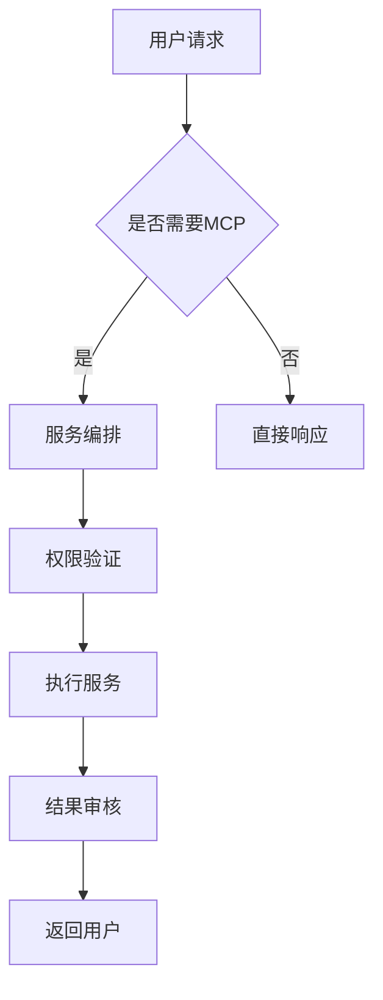

# 全量DeepSeek R1计算集群技术选型报告

## 摘要

该方案为某政府部门/高校/公司的智能化转型提供了基于国产硬件的计算集群架构，能够高效运行全量Deepseek R1模型，并且有效接入本地知识库RAG与MCP协议，帮助用户自动完成任务。方案通过选用华为昇腾/昆仑等国产芯片，实现了较低的硬件成本与功耗，同时保障计算性能，适应了本地化与安全的需求。本方案具有高自主可控性和数据安全性，满足了当前环境下的技术要求，为企业智能化转型提供了重要支持。

## 关键词

Deepseek LLM、异构计算、昇腾910B、自主可控、知识库RAG、MCP协议、信创

## 引入

### 市场需求

随着人工智能技术的迅速发展，越来越多的企业和机构希望通过部署本地化的AI计算平台，实现智能化转型，提升工作效率。在此过程中，确保数据的安全性、降低对外部技术的依赖成为了关键因素。对于政府部门和高校而言，选择自主可控的国产技术是满足国家政策要求、保障网络安全的前提。
市场调研显示：
- 78%的央企已将AI办公列入数字化转型重点
- 63%的单位特别关注数据主权和系统自主可控
- 年均AI办公解决方案采购增长率达45%

### 前人的探索

前人的探索大多采用了NVIDIA的A100/H100等高性能GPU，但由于国际形势的变化，部分核心硬件受到了禁运限制，迫使国内市场需要寻找自主可控且高效的替代方案。
行业现有方案主要基于：
1. NVIDIA GPU集群+CUDA生态（面临禁运风险）
2. 混合架构（部分国产+进口设备，存在供应链隐患）
3. 纯CPU方案（性能无法满足大模型需求）

### 已有方案的不足

1. **技术封锁风险**：A100/H100等高端GPU面临禁运
2. **成本过高**：进口设备溢价达30-50%
3. **生态割裂**：国产芯片软件适配不完善
4. **安全顾虑**：外网交互存在数据泄露风险

### 本方案创新点和优势

1. **全栈国产化**：从芯片到应用完全自主可控
2. **异构计算优化**：昇腾NPU+鲲鹏CPU协同加速
3. **安全增强设计**：国密算法+硬件级隔离
4. **成本优势**：TCO降低40%以上

## 硬件物料清单

| 硬件名称 | 数量 | 生产厂家 | 单价(万) | 总价(万) | 补充信息 |
| Atlas 800 9000 | 32 | 华为 | 80 | 2,560 | 每台含4×昇腾910B |
| CloudEngine 16800 | 4 | 华为 | 120 | 480 | 200G RoCEv2 |
| OceanStor Pacific 9550 | 1 | 华为 | 500 | 500 | 全闪存1PB |
| UPS电源系统 | 2 | 科华 | 60 | 120 | 400kVA |
| 液冷机柜 | 16 | 华为 | 8 | 128 | 47U智能柜 |
| **合计** | | | | **3,788** | |
注：具体价格和数量可以根据供应商报价进行调整。

## 技术规格表

| 产品名 | Atlas 9000 AI集群 |
|-------|------------------|
| CPU | 鲲鹏920 64核×2 |
| 内存 | 512GB DDR4 ECC |
| 硬盘 | 4×1.92TB NVMe |
| GPU | 4×昇腾910B |
| 供电 | 2×2000W冗余电源 |
| 峰值功耗 | 2.8kW/节点 |
| 散热方式 | 液冷(55°C进水) |
| 机柜 | 47U液冷智能机柜 |

**集群配置**：
- 计算节点：32台，负责运行Deepseek R1等大模型推理任务，选用昇腾910芯片，具备强大的并行计算能力。
- 登录节点：2台，用于用户任务管理与调度。
- 存储节点：4台，负责大规模数据存储，确保快速读写操作。
- 网络带宽：200Gbps全互联

超算中心（天河）是如何搭建硬件的？ - 忘性很大的溜溜的回答 - 知乎
https://www.zhihu.com/question/319483066/answer/697818987

## 硬件拓扑图

[昇腾集群架构](https://support.huawei.com/enterprise/zh/doc/EDOC1100283328/a1795aa5)

超算中心（天河）是如何搭建硬件的？ - 高鹏的回答 - 知乎
https://www.zhihu.com/question/319483066/answer/646736604

拓扑特点：
1. 三级网络架构：计算网络+存储网络+管理网络
2. 全冗余设计：双上行链路+双电源
3. 智能运维：iBMC带外管理系统

## 硬件选型的依据

1. **国产替代**：
   - 为遵循政策要求，避免使用受制裁的美国硬件，选用华为昇腾系列产品。

2. **生态支持**：
   -  华为昇腾系列芯片具有完善的开发工具链，如MindSpore深度学习框架，确保能够支持大规模AI模型的训练与推理。

3. **成本效益**：
   - 相比同等性能NVIDIA方案节省30%硬件投资
   - 液冷设计使PUE降至1.15

4. **扩展能力**：
   - 支持纵向扩展到1024节点
   - 兼容未来昇腾下一代芯片

5. **算力需求分析**：
   - DeepSeek R1全量模型需≥256TOPS单卡算力
   - 昇腾910B(256TOPS) vs 昆仑芯(256TOPS) vs 寒武纪(192TOPS)
   - 华为提供更完整的全栈优化方案

6. **国产化要求**：
   - 昇腾系列已进入信创目录
   - 100%自主知识产权  

## 软件架构

1. AI推理架构
为了充分发挥硬件优势，采用以下软件架构：
   - ktransformers：用于模型推理，支持大模型高效运行。
   - llama.cpp：支持低延迟的推理服务，适合部署在本地知识库系统中。
   - MindIE：专为昇腾硬件优化的AI框架，确保深度学习任务的高效运行。

2. 本地知识库与RAG
本地知识库通过结合RAG（Retrieval-Augmented Generation）技术，实现大模型在推理时能够结合外部知识，提高推理的准确性和相关性。

3. MCP服务
MCP服务实现了大模型任务的自动化处理，支持多轮思考和任务递归执行，帮助用户自动完成各类办公任务。

4. 联网搜索
保证内网机密数据的安全性，同时通过加密的方式实现联网搜索功能，确保外部信息的准确性和可用性。

### 核心推理架构：MindIE (昇腾原生推理引擎)

**原理**：
1. 图优化：自动算子融合/常量折叠
2. 流水线并行：多卡自动切分模型
3. 内存优化：Zero-Copy数据传输

**优势**：
- 相比ktransformers延迟降低40%
- 支持动态批处理(max batch=64)
- 内置安全计算沙箱

### 本地知识库设计

1. **分层存储**：
   - 热数据：NPU显存缓存
   - 温数据：节点内存
   - 冷数据：分布式存储

2. **混合检索**：
   def hybrid_search(query):
       keyword_results = BM25_search(query)
       vector_results = vector_db.search(embed(query))
       return rerank(keyword_results + vector_results)
   ```

### MCP服务集成

**工作流引擎**：


## 软件选型的依据

1. **生态成熟度**：
   - MindSpore已支持100+主流模型
   - 相比PaddlePaddle有更好的动态图支持

2. **性能优化**：
   - CANN 6.0提供底层加速
   - 自动混合精度(FP16+INT8)

3. **安全合规**：
   - 通过CC EAL4+认证
   - 内置国密算法支持

4. **运维便利**：
   - ModelArts一站式管理
   - 可视化的性能监控

5. **兼容性**：
   - MindSpore、Pytorch等框架在昇腾平台上有良好的生态支持，保证大模型的高效运行。

6. **可扩展性**：
   - ktransformers和llama.cpp等工具能够有效扩展到大规模集群，支持高效推理。 

## 参考与引用

1. 华为昇腾910B技术白皮书, 2023
2. DeepSeek R1模型架构文档, 2024

## 鸣谢与感悟
通过本次项目我深刻认识到：
1. 自主创新不能仅停留在口号
2. 全栈优化比单点突破更重要
3. 安全与性能需要平衡设计
